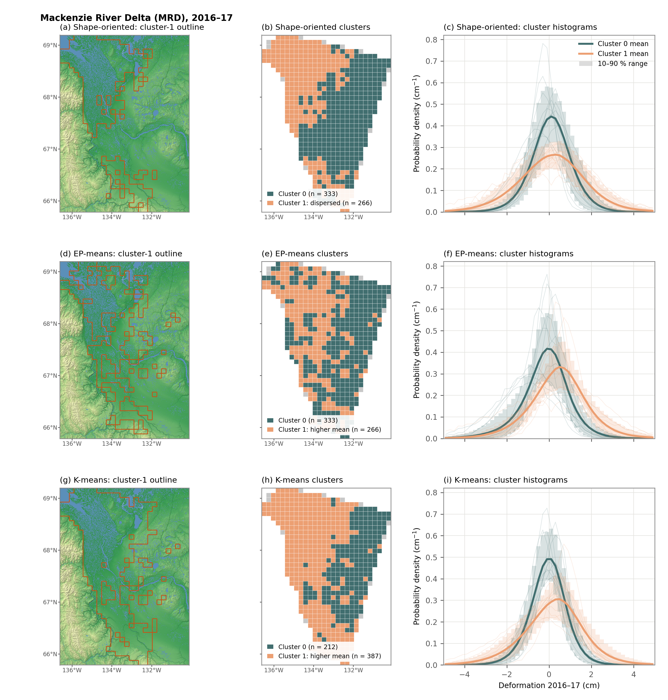

# so_clustering v1.0

**Shape-oriented clustering of distribution histograms**

`so_clustering` groups histograms (or any binned distributions) by the *shape* of
the distribution and is less dominated by the location of bins. Two distributions that are similar in form but
slightly translated (shifted) or permuted (re-ordered) are treated as close; and distributions with different modality, 
skewness, or tail behaviours are kept apart. 
This is an empirical algorithm intended for histograms computed over the same value range whose central locations 
are similar across samples, such as variations centred around zero.
**Example:**

<p>
  <strong>Example:</strong><br>
  
</p>

*Figure adapted from Liu et al. (in prep.): Distribution-Based Representation of InSAR Permafrost Deformation Preserves Subgrid Variability and Reveals Landscape Patterns, preprint version DOI: 10.22541/essoar.176548356.68541816/v1.*

## How it works

Given `n` histograms with a common set of bins (an array of shape `(n_samples, n_bins)`):
1. **Profiling.** Each sample (for example, a grid cell) is represented by the vector
   of its histogram bin heights, all calculated over the same value range (50 bins
   in the original application). This vector is the *frequency profile*.
2. **Initialise** `k` centroids with k-means++ (`sklearn.cluster.KMeans`).
3. **Assign** each histogram to the centroid with the smallest Wasserstein distance.
   The Wasserstein distance is computed on the profile instead of the raw values.
4. **Update** each centroid as the mean histogram of its members, i.e. 
5. **Iterate** steps 3–4 until the largest centroid shift is below `tol` (convergence) or `max_iter` is reached.

Taking the frequency profile instead of the full histogram reduces the weight of bin location.
Assigning frequency profiles with Wasserstein distance makes the clustering sensitive to shape. 
Using the mean as the centroid preserves the common shape of histograms in a cluster. 
Convergence can be set mannually (`tol`).
If you want to give more weight to the tail behaviour in clustering, normalise each histogram profile and take its square root before 
clustering, e.g. `model.fit(np.sqrt(H / H.sum(axis=1, keepdims=True)))`; 
centroids can be squared and renormalised to plot them as histograms again.


<!-- Distances are computed in closed form and vectorised over all
sample–centroid pairs. The results match `scipy.stats.wasserstein_distance`
to floating-point precision. -->


## API

### `ShapeOrientedClustering(n_clusters, max_iter=100, tol=1e-4, bin_centers=None, random_state=42)`

| Parameter | Description |
|---|---|
| `n_clusters` | Number of clusters. |
| `max_iter` | Maximum number of assign/update iterations. |
| `tol` | Stop when the largest centroid shift (Euclidean norm) is below this value. |
| `bin_centers` | Bin positions, or `None`; see above. Must be strictly increasing. |
| `random_state` | Seed for the k-means++ initialisation. |

| Method | Returns |
|---|---|
| `fit(H)` | the fitted model |
| `fit_predict(H)` | cluster label of each row of `H` |
| `predict(H)` | index of the nearest centroid for each row |
| `transform(H)` | `(n_samples, n_clusters)` Wasserstein distances |

| Attribute | Description |
|---|---|
| `centroids` | `(n_clusters, n_bins)` mean histogram of each cluster |
| `labels_` / `assignments` | cluster label of each training histogram |
| `n_iter_` | number of iterations run |
| `converged_` | whether the `tol` criterion was met |

`HybridClustering` is kept as an alias of `ShapeOrientedClustering` for code written
against the original version.

### `wasserstein_matrix(X, centroids, bin_centers=None)`

Pairwise Wasserstein distances between the rows of `X` and `centroids`. It can be used
on its own, for example for silhouette scores or to choose `n_clusters`.

## What the default mode can and cannot separate

The tests below use synthetic data with 30 histograms per group, 50 bins over [−8, 8], and the default
settings (`bin_centers=None`). Accuracy is the share of histograms assigned to the correct group;
with two groups, 50% is chance level.

### Unimodal vs. multimodal

Because bin location is ignored, a multimodal histogram is compared by its bar heights, not by where
its peaks are. It is separated from a unimodal one unless its peaks have the same height as the single
peak (mass proportional to width) **and** their widths sum to the single peak's width.

| Unimodal | Multimodal | Accuracy |
|---|---|---|
| σ = 0.5 | two σ = 0.5 peaks, equal mass | 100% |
| σ = 1 | two σ = 1 peaks, equal mass | 100% |
| σ = 1 | σ = 0.2 and σ = 0.8 peaks, equal mass | 100% |
| σ = 1 | two σ = 0.5 peaks, equal mass | 50% |
| σ = 2 | two σ = 1 peaks, equal mass | 50% |
| σ = 1 | σ = 0.2 and σ = 0.8 peaks, mass 20 / 80 | 50% |

In the three failing cases, the peak widths add up to the unimodal width and every peak reaches the
unimodal peak height. The histograms then contain the same set of bar heights, so they are
indistinguishable in this mode.

### Skewness and tail behaviour

Each shape is standardised to mean 0 and standard deviation 1 and compared with the Gaussian that
resembles it most in this mode (the hardest case). Columns give the number of samples per histogram.

| Shape | 100 | 300 | 1,000 | 5,000 |
|---|---|---|---|---|
| Exponential (strong skew) | 91% | 98% | 100% | 100% |
| Laplace (sharp peak, fat tails) | 87% | 99% | 100% | 100% |
| Student-t ν=5 | 56% | 75% | 100% | 100% |
| Skew-normal α=5 (moderate skew) | 54% | 62% | 63% | 99% |
| Gamma k=4 (skewness ≈ 1) | 54% | 56% | 72% | 99% |

Against a Gaussian with the same standard deviation, all of these shapes are separated (100% at
2,000 samples per histogram).

### Summary

- **Separated well:** differences in peakedness and spread, strong asymmetry, and multimodality where
  the peak heights differ from the unimodal peak.
- **Needs large samples:** moderate skewness (skewness ≲ 1) looks like a slightly narrower Gaussian
  and is separated reliably only with several thousand samples per histogram.
- **Weighted weakly:** tail behaviour. Bins in the tails have heights close to zero and contribute little
  to the distance (3–31% in these tests), so tail differences matter mainly when they come with a
  sharper or flatter peak.
- **Not separated:** multimodal histograms whose peaks match the unimodal peak height and whose widths
  sum to the unimodal width.
  

## Notes and limitations

- All histograms must share the same bins.
- This clustering is an empirical one, which means the convergence, sample size, 
cluster number have to be adjusted based on the nature of the data and the user's needs.

<!--
- Results depend on the k-means++ initialisation. Try a few `random_state` values,
  or compare runs, before settling on a solution.
- Assignment cost is O(n_samples × n_clusters × n_bins) per iteration.
  Memory use scales the same way, because the distance matrix is built in one step.
-->


## Citation

If you use this code, please cite the repository:

```bibtex
@software{liu_so_clustering,
  author = {Liu, Zhijun},
  title  = {so\_clustering: shape-oriented clustering of distributions},
  year   = {2026},
  url    = {https://github.com/anALPAKKA/so_clustering}
}
```

## License

BSD 3-Clause. See [LICENSE](LICENSE).
