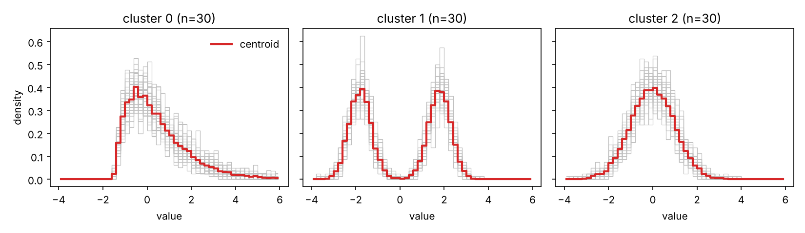

# so_clustering

**Shape-oriented clustering of distributions.**

`so_clustering` groups histograms (or any binned distributions) by the *shape* of
the distribution rather than by bin-by-bin differences. It is a k-means-style
algorithm in which the assignment step uses the Earth Mover's distance
(1-D Wasserstein distance), so two distributions that are similar in form but
slightly shifted are treated as close, and distributions with different modality
or skewness are kept apart.



## How it works

Given `n` histograms with a common set of bins (an array of shape `(n_samples, n_bins)`):

1. **Initialise** `k` centroids with k-means++ (`sklearn.cluster.KMeans`).
2. **Assign** each histogram to the centroid with the smallest Wasserstein distance.
3. **Update** each centroid as the mean histogram of its members. If a cluster is empty, it keeps its previous centroid.
4. **Repeat** steps 2–3 until the largest centroid shift is below `tol` or `max_iter` is reached.

Using the mean as the centroid keeps the update cheap and makes every centroid a
valid histogram. The Wasserstein assignment is what makes the clustering sensitive
to shape. Distances are computed in closed form and vectorised over all
sample–centroid pairs. The results match `scipy.stats.wasserstein_distance`
to floating-point precision.

## Installation

```bash
git clone https://github.com/anALPAKKA/so_clustering.git
cd so_clustering
pip install .
```

Requirements: Python ≥ 3.9, NumPy, SciPy and scikit-learn (see `requirements.txt`).
The example also needs matplotlib.

## Quick start

```python
import numpy as np
from so_clustering import ShapeOrientedClustering

edges = np.linspace(-4, 6, 51)
centers = 0.5 * (edges[:-1] + edges[1:])

# H: array of shape (n_samples, n_bins), one histogram per row
H = np.array([np.histogram(sample, bins=edges, density=True)[0] for sample in samples])

model = ShapeOrientedClustering(n_clusters=3, bin_centers=centers)
labels = model.fit_predict(H)

model.centroids        # (3, n_bins) mean histogram of each cluster
model.predict(H_new)   # assign new histograms to the nearest centroid
model.transform(H_new) # Wasserstein distance to every centroid
```

For a complete example that draws Gaussian, right-skewed and bimodal samples and
makes the figure above, run:

```bash
python examples/synthetic_example.py
```

## Choosing the distance: `bin_centers`

The Wasserstein distance can be applied to a histogram row in two ways, controlled by
`bin_centers`:

| `bin_centers` | Each row is treated as… | Equivalent SciPy call |
|---|---|---|
| array of bin positions (**recommended**) | weights (counts or densities) at those positions | `wasserstein_distance(bin_centers, bin_centers, row, centroid)` |
| `None` (default) | a set of sample values | `wasserstein_distance(row, centroid)` |

With `bin_centers` given, the distance compares how probability mass is spread
along the value axis, which is what "distribution shape" usually means. Rows are
normalised to sum to one, so raw counts and densities both work.

With `bin_centers=None`, the bin heights themselves are compared as samples, so bin
order does not matter: shuffling the bins of a histogram gives a distance of zero to
the original. This mode reproduces the original `HybridClustering` implementation exactly
and is kept so earlier results can be reproduced.

## API

### `ShapeOrientedClustering(n_clusters, max_iter=100, tol=1e-4, bin_centers=None, random_state=42)`

| Parameter | Description |
|---|---|
| `n_clusters` | Number of clusters. |
| `max_iter` | Maximum number of assign/update iterations. |
| `tol` | Stop when the largest centroid shift (Euclidean norm) is below this value. |
| `bin_centers` | Bin positions, or `None`; see above. Must be strictly increasing. |
| `random_state` | Seed for the k-means++ initialisation. |

| Method | Returns |
|---|---|
| `fit(H)` | the fitted model |
| `fit_predict(H)` | cluster label of each row of `H` |
| `predict(H)` | index of the nearest centroid for each row |
| `transform(H)` | `(n_samples, n_clusters)` Wasserstein distances |

| Attribute | Description |
|---|---|
| `centroids` | `(n_clusters, n_bins)` mean histogram of each cluster |
| `labels_` / `assignments` | cluster label of each training histogram |
| `n_iter_` | number of iterations run |
| `converged_` | whether the `tol` criterion was met |

`HybridClustering` is kept as an alias of `ShapeOrientedClustering` for code written
against the original version.

### `wasserstein_matrix(X, centroids, bin_centers=None)`

Pairwise Wasserstein distances between the rows of `X` and `centroids`. It can be used
on its own, for example for silhouette scores or to choose `n_clusters`.

## Notes and limitations

- All histograms must share the same bins.
- Results depend on the k-means++ initialisation. Try a few `random_state` values,
  or compare runs, before settling on a solution.
- Assignment cost is O(n_samples × n_clusters × n_bins) per iteration.
  Memory use scales the same way, because the distance matrix is built in one step.

## Tests

```bash
pip install pytest
pytest
```

The tests check both distance modes against `scipy.stats.wasserstein_distance`. They also
check that the package gives identical labels and centroids to the original
implementation.

## Citation

If you use this code, please cite the repository:

```bibtex
@software{liu_so_clustering,
  author = {Liu, Zhijun},
  title  = {so\_clustering: shape-oriented clustering of distributions},
  year   = {2026},
  url    = {https://github.com/anALPAKKA/so_clustering}
}
```

## License

BSD 3-Clause. See [LICENSE](LICENSE).
